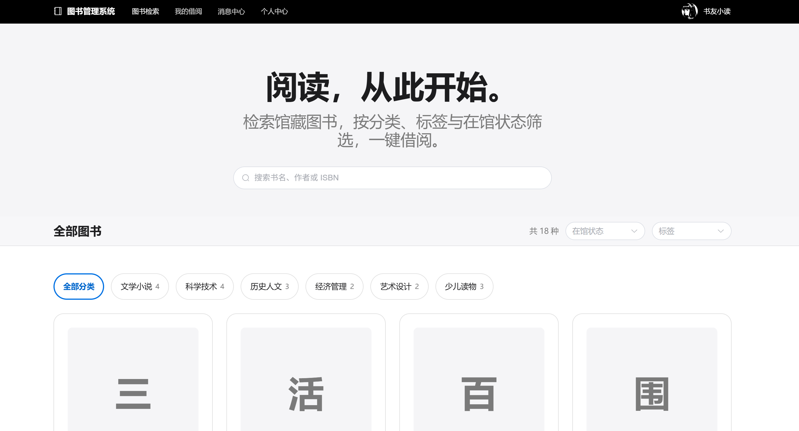

## 图书管理系统

本项目为一个在线图书管理系统，采用前后端分离架构。当前仅支持WEB访问，后续可能支持APP/H5/小程序访问。

## 主要功能
1. **图书管理功能**
  - 支持图书的增删改查操作，包括图书信息的添加、编辑、删除和查询。
  - 图书支持封面图展示，如果未上传则显示图书名第一个文字作为封面图。
  - 提供图书分类管理，能够对图书进行分类和标签管理，便于用户查找时的筛选。
  - 管理员后台有个仪表盘，支持统计图书借阅历史趋势。按天/周/月维度统计。

2. **用户管理功能**
  - 提供用户注册、登录和权限管理功能。支持基于JWT（JSON Web Token）的认证机制。
  - 角色提供管理员、普通用户、VIP用户。管理员可进行系统设置、用户管理、图书管理等操作。

3. **会话管理功能**
  - 支持自动刷新AccessToken，当发现AccessToken超时的时候，自动使用RefreshToken来换新的Token。

4. **借阅与归还管理**
  - 用户可借阅图书，并查看自己的借阅记录和预期图书。
  - 管理员可查看所有用户的借阅状态并进行相关的管理操作，比如催还、归还确认等。

5. **搜索与筛选功能**
  - 提供图书标题、作者、ISBN号等字段的搜索功能。
  - 支持按分类、状态等条件对图书进行筛选，提示用户体验。

6. **图书评分与评论功能**
  - 支持用户在图书详情页面对每一本图书进行评分和评论。满分5分，使用五角星标识评分。
  - 评分为可选，如果不选则默认为0分，评论是必填的并且字数必须大于5个字。支持多次给同一个图书评分和评论。最终评分为平均值
  - 在图书搜索的结果列表页面，每本图书卡片中也需要显示评分，仍然使用五角星显示。

7. **消息中心**
  - 管理员能发布系统全局消息
  - 用户在消息中心能看到管理员发布的消息，并且还要区分未读和已读状态消息。

8. **个人中心**
  - 支持用户在个人中心查下和修改基本信息。
  - 个人信息包括用户名、昵称、邮件、手机号、头像。可以编辑昵称、邮件、手机号、头像。用户名不可修改。
  - 头像支持上传webp、png、jpeg格式图片，大小100K以内。

## 技术架构

采用前后端分类技术架构，前端采用Vue3全家桶技术栈，后端采用Python WEB技术栈实现。

### 前端技术栈
- Vue 3.4（Compsition API）
- Vite 5.x（构建工具）
- Pinia 2.x（状态管理）
- Vue Router 4.x（路由）
- Axios（HTTP客户端）
- Element Plus 2.x（UI组件库）
- TypeScript 5.x（前端编程语言）
- Echarts 6.x（页面统计图表）

### 后端技术栈
- FastAPI 0.109+（WEB框架）
- Uvicorn（ASGI服务器）
- Pydantic 2.x（数据校验）
- python-jose（JWT认证）
- passlib（密码加密）

后端Python依赖和环境、以及项目管理请使用uv统一管理。

### 中间件
- SQLite（数据库）

## 本地开发测试
- 提供本地测试环境，前端默认运行在`http://localhost:5173/`，并提供管理员和普通用户的账号用于测试。
- 管理员：`admin / admin123`；普通用户：`user / user123`；VIP 用户：`vip / vip123`
- 包含详细的启动文档（`backend/README.md`和`frontend/README.md`），方便开发者快速启动和部署项目。

## 前端UI规范
- 界面设计遵循 [DESIGN.md](./DESIGN.md)（Apple 风格设计语言）：单一强调色 Action Blue `#0066cc`、SF Pro 字体栈与负字距标题、胶囊形态主操作按钮、白色/羊皮纸画布分区、卡片细边界且不使用阴影。
- 所有 UI 必须使用 `frontend/src/styles/main.css` 中定义的设计令牌（CSS 变量），不得在组件中引入规范之外的颜色与字体。

## 效果图

